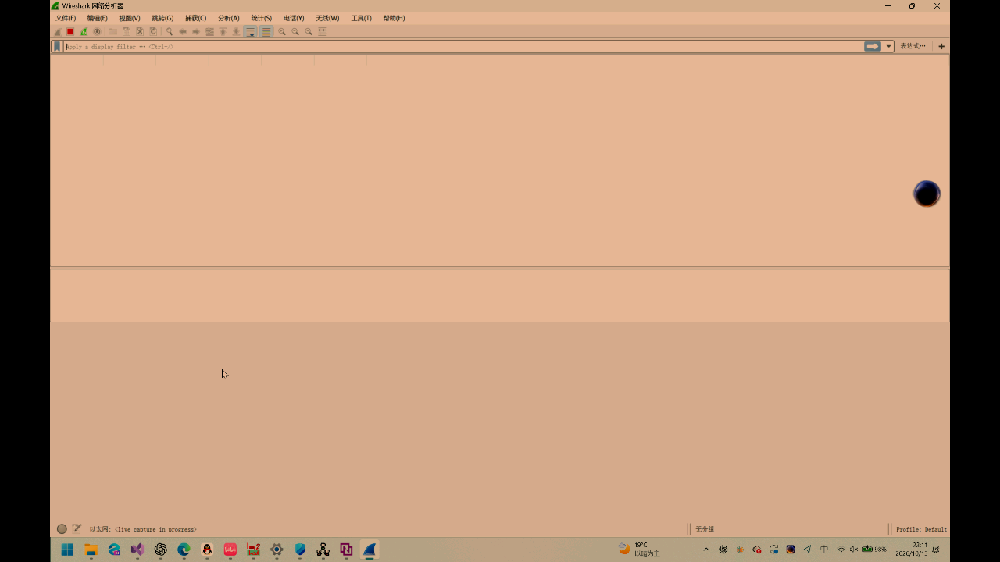
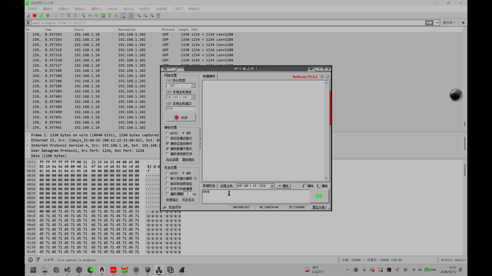
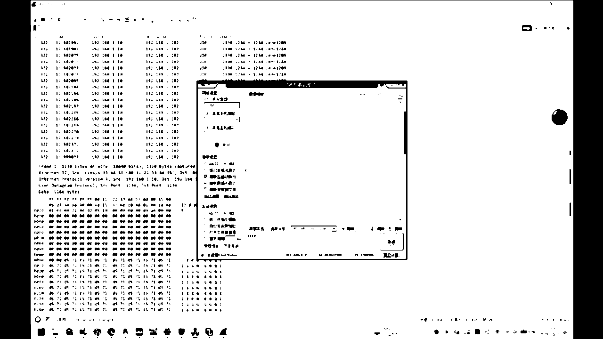

# drive_system：FPGA 多路视频处理与辅助驾驶演示系统

基于 Pango Logos2 PG2L100H，实现三路 OV5640、HDMI 和以太网视频输入，以及多画面显示、鸟瞰映射、图像处理、图形叠加、超声波告警和串口语音播报。

正式工程入口：[prj/drive_system.pds](prj/drive_system.pds)。顶层模块：`top_dual_ov5640_hdmi`。

## 1. 功能与数据流

- **五路输入、四路 DDR 画面**：摄像头1、摄像头2、BACK_LEFT 可选源、以太网；BACK_LEFT 可在摄像头3和 HDMI 之间切换。
- **HDMI 图像处理**：HDMI 采集后先做自动夜间增强，再进入 RGB、YRG、灰度化 → 3×3 中值滤波 → 自适应二值化三条支路。相机和以太网输入不经过这条 HDMI 处理链。
- **独立选模**：本地显示处理模式由按键选择；GE1 发送的处理模式由以太网指令选择，二者独立。上电默认显示 HDMI RGB888 全屏，网络默认发送 HDMI RGB565。
- **多种显示布局**：HDMI 全屏、四宫格、任一路 DDR 放大全屏、四路鸟瞰映射。四宫格和放大画面均显示源名称；以太网尚未收到首帧时仍显示名称。
- **叠加及交互**：箭头采用自身色系渐变，可同时显示多个箭头；网络箭头/边缘警告只叠加在 HDMI RGB 全屏。机械键用于方向交互和错误方向报警。
- **超声波告警**：三级距离判定、分级颜色与蜂鸣、128×128 中央标志约 2 Hz 闪烁；告警时强制四宫格并屏蔽显示切换。
- **语音调度**：JQ8900 串口按文件名播放，高优先级事件可打断低优先级事件；持续事件不循环重播，失效的待播事件取消。

这里的“原始/RGB 直通”指不选 YRG 或二值化支路；它仍位于自动夜间增强之后。

鸟瞰显示使用仓库内既有坐标映射参数，并跟随 BACK_LEFT 源选择。参数来自原演示布置；更换摄像机安装位置后，需要结合实际成像检查映射效果。

## 2. 硬件与运行条件

| 项目 | 配置 |
| --- | --- |
| FPGA | PG2L100H，FBG484，速度等级 -6 |
| 开发工具 | PDS 2022.2-SP4.2，原验证 Build 132111 |
| 板载系统时钟 | 50 MHz |
| HDMI 输入 | ADV7611；固定 1280×720@60 Hz |
| HDMI 输出 | 1280×720；像素及 TMDS 时钟由输入恢复时钟同源产生 |
| 摄像头 | 三路 OV5640，单路画面 640×360；双目接 J4，单目沿用板上原单目位置 |
| DDR | 板载 DDR3，接口和 IP 配置以工程为准 |
| 以太网 | GE0 接收 BACK_RIGHT 图像；GE1 接收控制命令、发送 HDMI 处理图像 |
| 超声波 | Trig=E16，Echo=D16；使用本项目适配的 3.3 V 模块 |
| 语音 | FPGA TX=D15 → JQ8900 RX，共地，9600 baud、8N1；模块预装指定音频 |
| 状态灯 | LED0 表示 ADV7611 初始化完成 |

完整管脚与电平请查看 [板级约束](prj/source/top_dual_ov5640_hdmi_pin.fdc)。以上接线对应原开发板，不能仅依据接口名称换用其他板卡。

演示时先接好 HDMI 输入源和输出显示器；显示时钟依赖 HDMI 输入恢复时钟，不把“完全没有 HDMI 输入”作为独立显示工作模式。五路输入分别来自三路相机、HDMI 源和 GE0 电脑，展示全部功能需要对应的外部设备。

GE0 和 GE1 按两个独立物理网络使用，可分别直连两台电脑；PHY 复位共用。两路沿用相同的 FPGA IP/MAC，不应直接合并到同一二层网络。

## 3. 本地操作

触摸键单击需等待约 400 ms 双击判定窗口；长按门限约 1 s。

| 当前界面 | 操作 | 结果 |
| --- | --- | --- |
| HDMI 全屏 | 触摸单击 | 进入四宫格 |
| 四宫格 | 触摸单击 | 返回 HDMI RGB 全屏 |
| DDR 放大全屏 | 触摸单击 | 返回四宫格 |
| 任一正常显示布局 | 触摸双击 | 进入鸟瞰；鸟瞰下再次双击退出到 HDMI RGB 全屏 |
| HDMI 全屏 | 长按触摸键，同时按 key0 / key1 / key2 | 选择 RGB / YRG / 自适应二值化显示 |
| 四宫格 | 长按触摸键 | BACK_LEFT 在摄像头3与 HDMI 之间切换；每次长按只切换一次 |
| 四宫格 | key0 / key1 / key2 / key3 | 分别放大 FRONT_LEFT / FRONT_RIGHT / BACK_LEFT / BACK_RIGHT |

四宫格位置：左上 FRONT_LEFT，右上 FRONT_RIGHT，左下 BACK_LEFT，右下 BACK_RIGHT。BACK_LEFT 上电默认摄像头3，切换后四宫格、放大和鸟瞰使用同一选择。

HDMI RGB 全屏时，key0/key1/key2 分别模拟左/右/前：对应箭头已显示且为绿、蓝、黄时，按下期间只保留对应箭头并闪烁；红色或未显示时触发对应箭头闪烁和蜂鸣，未显示箭头临时使用红色。key3 使已叠加的红色直行箭头或黄色边缘警告闪烁，不触发机械蜂鸣。其他显示布局不叠加这套网络箭头交互。

超声波黄色约对应 15～20 cm（1 Hz 蜂鸣），橙色约对应 10～15 cm（2 Hz），红色约对应 10 cm 内（5 Hz）；具体边界按 RTL 计数阈值。告警期间边缘常亮，中央标志闪烁，机械方向报警暂停。告警结束后：原四宫格恢复四宫格，原鸟瞰恢复鸟瞰，其余状态返回 HDMI RGB 全屏；支持回波超时与无新回波清除。

## 4. 以太网协议

默认 FPGA 地址 `192.168.1.10`、MAC `00:11:22:33:44:55`，电脑目标地址 `192.168.1.102`。UDP 发送端源/目的端口均为 `1234`，调试控制建议使用该端口。电脑网卡配置同网段地址。

### GE1：两字节控制命令

网络调试助手选择 **HEX**，每包恰好两个字节，低字节 `[7:0]` 先发、高字节 `[15:8]` 后发；所有未使用高位补零。

| 位 | 含义 |
| --- | --- |
| bit0 / bit1 / bit2 | 左 / 右 / 直行箭头，1 显示、0 不显示 |
| bit3 | 黄色边缘警告，1 显示 |
| bit[5:4] | 左箭头颜色 |
| bit[7:6] | 右箭头颜色 |
| bit[9:8] | 直行箭头颜色 |
| bit[11:10] | GE1 图像发送模式 |
| bit[15:12] | 保留，必须为 0 |

颜色：`00` 红、`01` 绿、`10` 蓝、`11` 黄。发送模式：`00` RGB565，`01` YRG，`10` 灰度化＋中值滤波＋自适应二值化，`11` 无效。包长不为 2、保留位非零或模式为 `11` 时，不更新上一条有效指令。

| HEX 载荷 | 含义 |
| --- | --- |
| `00 00` | 不显示箭头/边缘警告，发送 RGB565 |
| `11 00` | 绿色左箭头，发送 RGB565 |
| `82 00` | 蓝色右箭头，发送 RGB565 |
| `08 00` | 黄色边缘警告，发送 RGB565 |
| `00 04` | 无叠加，发送 YRG |
| `00 08` | 无叠加，发送自适应二值化 |

整条有效指令替换上一状态；例如 `11 00` 后发送 `00 04`，会同时撤下箭头并切换发送模式。

GE1 发送 UDP 图像载荷为 1288 字节：8 字节图像头加 1280 字节像素。RGB565 每行两个包，16 位像素高字节在前；YRG/二值化每行一个包。8 位编码中 0～253 为灰度，254 为红色，255 为绿色，二值结果使用 0/253。详细解析见 [抓包还原工具](tools/reconstruct_image_pcap.py)。发送支路不含本地箭头和超声波警告叠加。

### GE0：视频接收

接收连续的 640×360 RGB565 像素字节流，每像素高字节先发，不套用 GE1 的 8 字节图像头。数据经 DDR 显示为 BACK_RIGHT；收到首个完整帧后开放视频画面。电脑发送端需遵循现有字节流顺序，不能直接把 GE1 抓包载荷原样作为 GE0 输入。

## 5. 语音文件与事件

JQ8900 FLASH 根目录预装 `00001.mp3`～`00007.mp3`，FPGA 使用文件名路径播放。音频需单独准备，本仓库不包含音频文件和语音模块固件。

| 文件名 | 事件/原音频标识 |
| --- | --- |
| `00001.mp3` | 蓝色箭头事件，navigation |
| `00002.mp3` | 运行中进入夜间增强，night |
| `00003.mp3` | 错误方向报警，wrong_turn |
| `00004.mp3` | 红、绿、黄单箭头指令事件，police |
| `00005.mp3` | 黄色边缘警告，zebra_crossing |
| `00006.mp3` | 超声波黄色告警，warn_1 |
| `00007.mp3` | 超声波红色告警，warn_3 |

优先级由高到低：超声波红 ＞ 超声波黄 ＞ 错误方向 ＞ 斑马线 ＞ 夜间 ＞ 蓝色箭头 ＞ 红绿黄单箭头。橙色超声波不播报。

第 4 段仅在“上一有效命令不属于红绿黄单箭头 → 当前命令属于红绿黄单箭头”时触发。连续合格单箭头换方向或颜色不重播；蓝色单箭头只保留原第 1 段事件，切回红绿黄单箭头可再次触发第 4 段。若有更高优先级播报，则有效事件等待，失效即取消。

夜间启动时先建立稳定基线，初始夜景不立即播报；稳定后观察到日间，再进入夜间时才播报。RGB、YRG、二值化 HDMI 全屏均可播报 night。

## 6. 工程目录与构建

| 路径 | 用途 |
| --- | --- |
| `rtl/` | 设计 RTL，按控制、视频、网络、外设等分类 |
| `prj/drive_system.pds` | 正式 PDS 工程入口 |
| `prj/ipcore/` | 必需 IP 配置、生成 RTL、加密源码、IP 约束及配套仿真文件，需完整保留 |
| `prj/source/` | 板级管脚与时序约束 |
| `sim/` | 功能仿真测试源码 |
| `tools/` | 可选的抓包图像还原工具及 Python 依赖清单 |
| `analysis/test_data_3_reconstructed/` | 历史抓包还原图像和分析结果，不参与构建 |
| `artifacts/bitstream/` | 已验证版本的比特流及掩码 |
| `artifacts/reports/` | 历史构建报告、清理记录和提交包静态核对结果 |

从仓库根目录打开 `prj/drive_system.pds`，先 Compile，再运行综合、器件映射、布局布线、时序检查和比特流生成。工程输入均使用相对路径；目录名和 PDS 文件更名不要求修改顶层模块名。

命令行方式（先把本机 PDS 的 bin 加入 PATH）：

```powershell
pds_shell.exe -project prj/drive_system.pds -run gen_bit_stream -work_dir prj
```

输出位于 `prj/generate_bitstream/`。构建数据库和日志已清理，首次打开显示历史输出文件缺失时，应从 Compile 开始重建。`.gitignore` 忽略这些可重新生成的文件，不忽略 `prj/ipcore/` 和 `artifacts/`。

ModelSim 的根目录 `work` 映射已改为相对路径。IP 配套仿真脚本仍可能包含 IP 生成机器的厂商仿真库路径；运行 DDR 等 IP 仿真时，需要按本机 PDS/ModelSim 安装配置库。

## 7. 验证与复现

### 构建基线

保留的报告和比特流来自 **2026-10-31** 的构建，布局种子为 4；这些是已有结果。本次复制、更名后的检查为输入引用与文件哈希核对，未在新目录重跑完整综合/布线，也不等同于新一次上板验证。

- 工程输入引用 171 条，全部存在，且逐项与此前通过时序的原工程一致。
- [时序报告](artifacts/reports/top_dual_ov5640_hdmi.rtr)：`All Constraints Met`，最小建立时间裕量约 0.370 ns；该结论针对报告中已有约束，外部 I/O 的未约束提示可在报告内查看。
- 主要建立时间裕量：HDMI 输入 1.257 ns，GE0 2.514 ns，GE1 0.460 ns，pixel_clk 4.054 ns。
- [综合报告](artifacts/reports/top_dual_ov5640_hdmi.snr)：LUT 39.06%，寄存器 12.61%，DRM 56.77%，APM 25.83%，锁存器 0。
- [现成比特流](artifacts/bitstream/top_dual_ov5640_hdmi.sbit) SHA256：`77E7FE8B7BA57F0A21D3A7ED3AF14972FAF7AADA4A7620AC75CE1A2E0E51EAC0`。

### 功能仿真

测试包括单箭头颜色与指令切换、UART 路径/校验和、优先级抢占、启动误播抑制、待播取消、两字节命令解析，以及其他显示和 DDR 单元测试。以下独立语音/指令测试不需要完整板级或 DDR IP 仿真：

```powershell
vlib work
vmap work work
vlog -sv -work work rtl/ethernet/udp_command_decoder.v rtl/peripheral/voice/voice_uart_tx.v rtl/peripheral/voice/jq8900_command_tx.v rtl/peripheral/voice/voice_event_ctrl.v sim/tb_voice_single_arrow.sv sim/tb_voice_event_ctrl.sv sim/tb_voice_startup.sv sim/tb/tb_ge1_command.sv
vsim -c -lib work tb_voice_single_arrow -do "run -all; quit -f"
vsim -c -lib work tb_voice_event_ctrl -do "run -all; quit -f"
vsim -c -lib work tb_voice_startup -do "run -all; quit -f"
vsim -c -lib work tb_ge1_command -do "run -all; quit -f"
```

上述四项在原工程使用 ModelSim SE-64 2020.4 验证通过，日志应输出各测试的 `PASS`，并检查无 `FAIL`/`Fatal`。其他测试台见 `sim/`，应按所测模块加入对应源文件，不把所有测试台视作同一个顶层。

### Wireshark 抓包图像还原

Python 3.10 或以上版本，先安装可选工具依赖：

```powershell
python -m pip install -r tools/requirements.txt
python tools/reconstruct_image_pcap.py test_data_3.pcapng analysis/new_capture
```

`test_data_3.pcapng` 为外部抓包输入，不随仓库提供；也可替换为自己抓取的兼容协议文件。工具输出三类还原图像及 JSON 报告。

[已有还原报告](analysis/test_data_3_reconstructed/summary.md)及示例：

| RGB565 | YRG | 二值化 |
| --- | --- | --- |
|  |  |  |

这些图片验证对应历史抓包的图像传输，不能替代所有后续版本与硬件组合的上板测试。

## 8. 来源说明

工程保留了原开发板示例代码和 Pango IP 的原始署名、文件头及配套说明。作者信息、赛事要求的报告、演示视频等应按实际报名信息和赛事提交规范提供，本 README 只说明本工程的构建、操作和验证方式。
